<div align="center">

# 🌌 The VibeVerse

### A whole universe of AI-built games, and every one of them is just a link.

**[myvibeverse.com](https://myvibeverse.com)** · [Every world on one page](https://myvibeverse.com/game) · [Watch the 30 second trailer](https://jack-clips.vercel.app/e7502921)

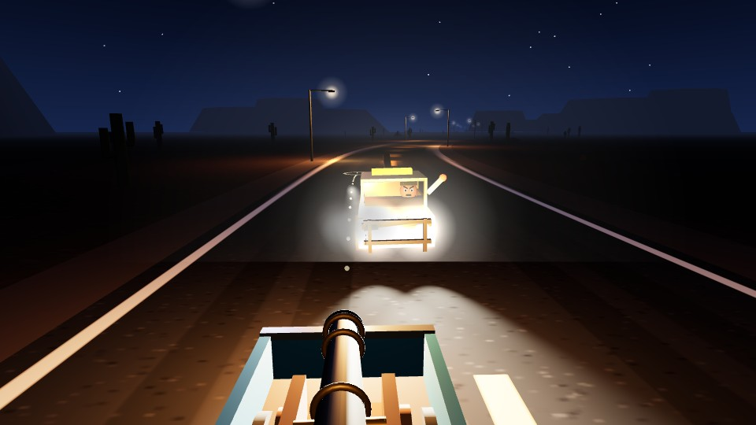 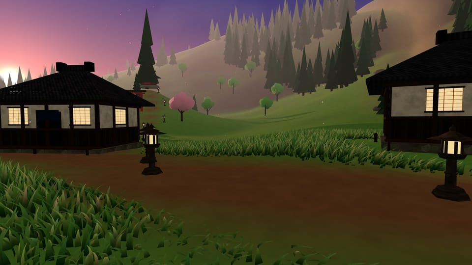 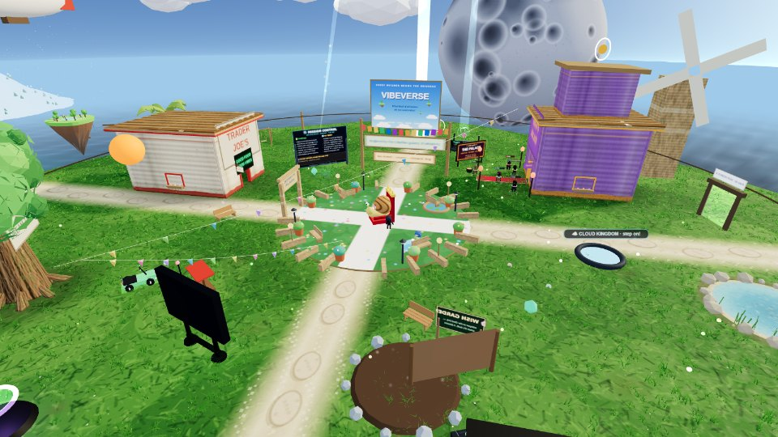
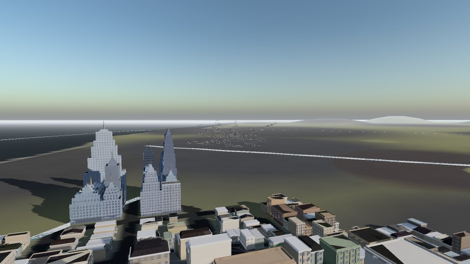 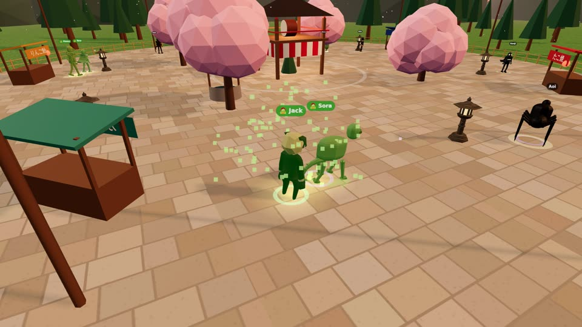 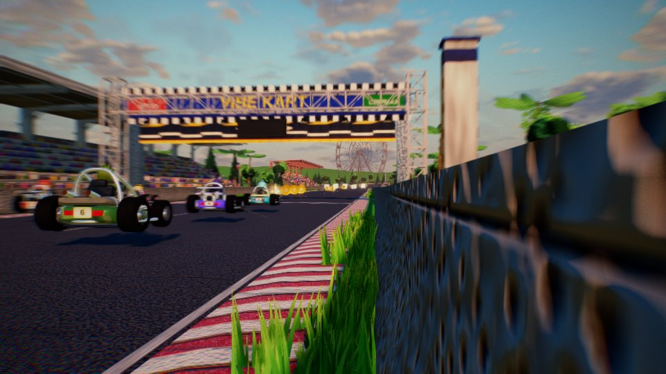

</div>

---

Send somebody a link. A few seconds later they are driving a pickup truck with
a pirate cannon bolted in the back, or standing in a Japanese valley telling a
wizard robot to make it snow, or running from a zombie in a festival square
with six friends on their phones.

No install. No account. No launcher. No app store. **Just a link.**

The VibeVerse is **65+ worlds and games** in one website: an open-world San
Francisco in the city's real weather, a GTA-style island with cops and
helicopters, a night highway chase with its own TV news channel, a voice
world you talk into existence, arcade racers, battle royales, physics golf,
a galaxy you fly a survey ship through, and a lot of beautifully strange
little places in between. Every line of it was vibe-coded, and the
universe keeps growing, sometimes while you are standing in it.

> **By the numbers:** ~720,000 lines of TypeScript · 65+ playable worlds ·
> 100+ routes · 33 edge functions · 130+ test files · one link.

---

## ✨ The headliners

### 💣 Cannon Chase · [`/cannon-run`](https://myvibeverse.com/cannon-run)

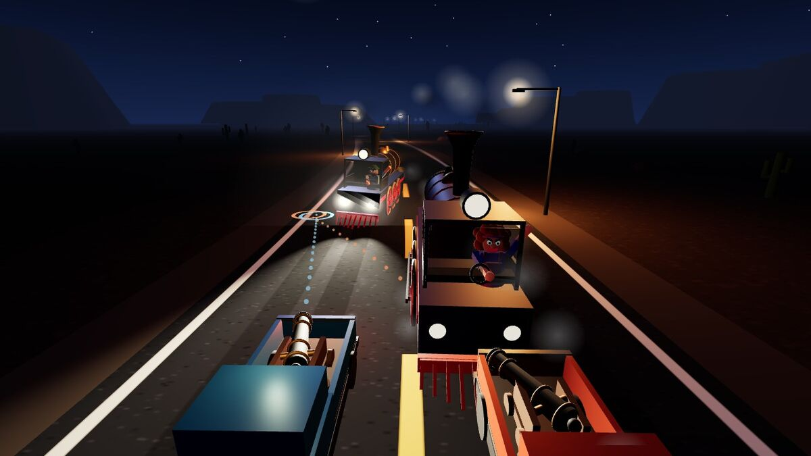 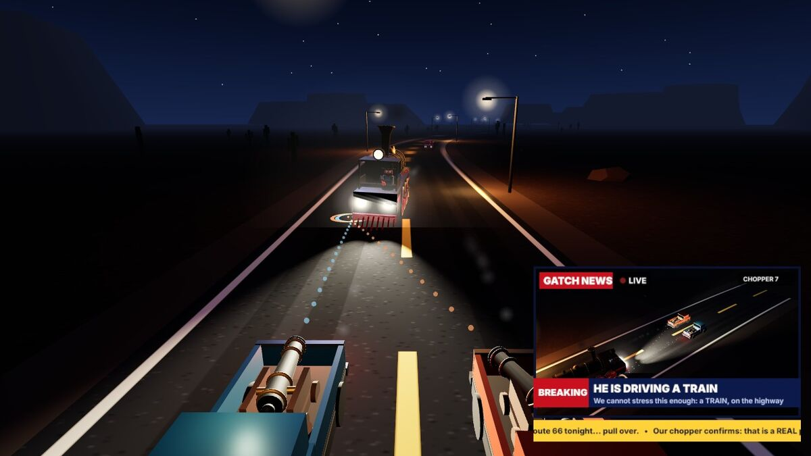

Midnight on a desert highway. You stole **Mad Mort's** ship's cannon, it is
bolted into the bed of your pickup, and he wants it back. Swerve, hit the
nitro, lob iron at him until his truck gives up... and then he comes back in
something bigger. A wagon. A tow truck. A monster truck. A cement mixer. An
18-wheeler. **A freight train.** And then another train, because the chase
never ends.

- **Lunatic Linda**, Mort's cousin with the orange hair and the grinding
  teeth, joins the hunt in two-player.
- **Two players** on one keyboard, or a friend joins **from their phone** by
  scanning a QR code.
- **Junkyard henchmen** in ridiculous hats show up as backup: *"Go get 'em, guys!"*
- **Gatch News** covers your chase live from a news chopper, picture in
  picture, with BREAKING headlines and Gatch Radio between bulletins.
- **Replay:** the game records every bulletin, so the end screen hands you
  the Gatch News replay of your own run.
- **The story book** (`?story`) tells how it all started, in a one-player and
  a two-player version.
- A garage to spend your cash in, a Thanksgiving mode, and an aurora sky.

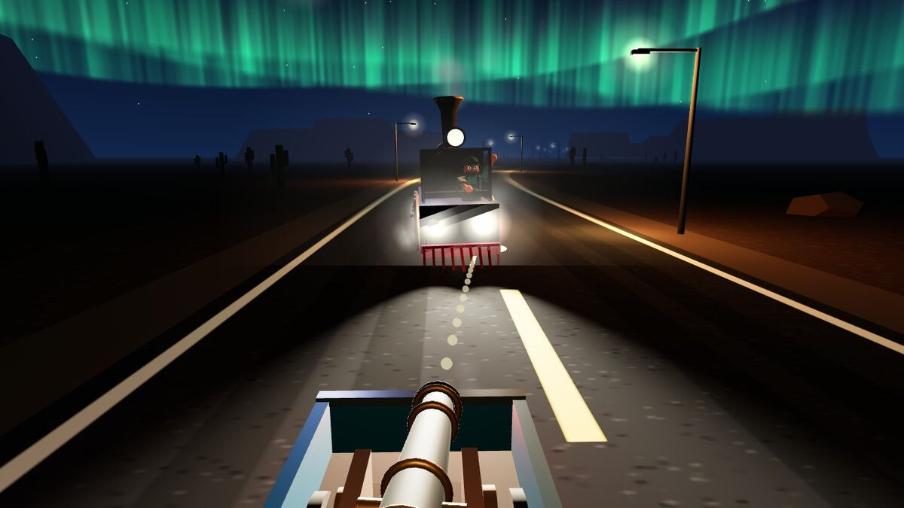 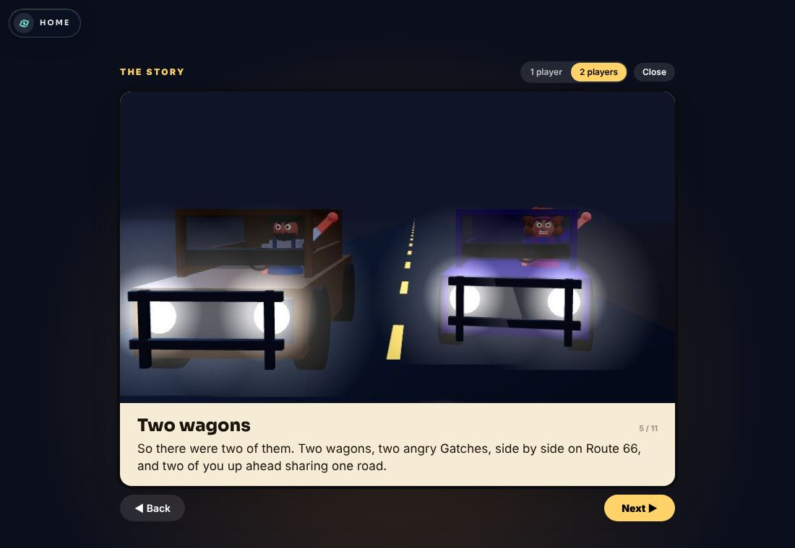

### 🏝️ Vibe Island & Vibe City: GTA Junior · [`/city`](https://myvibeverse.com/city)

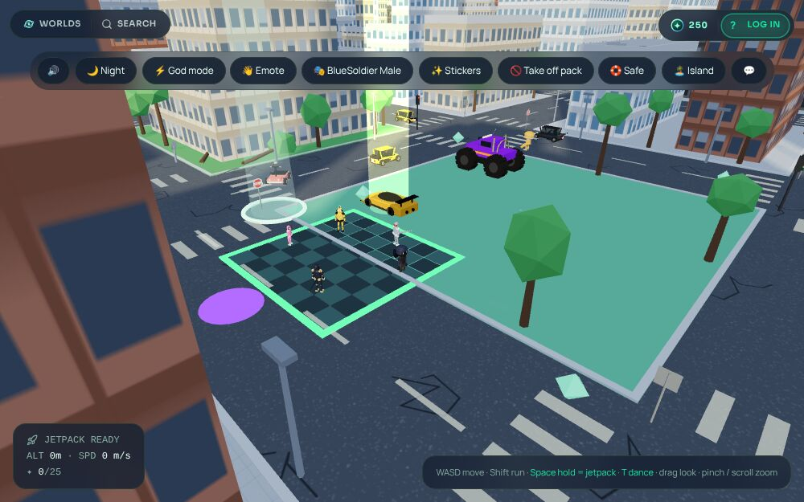 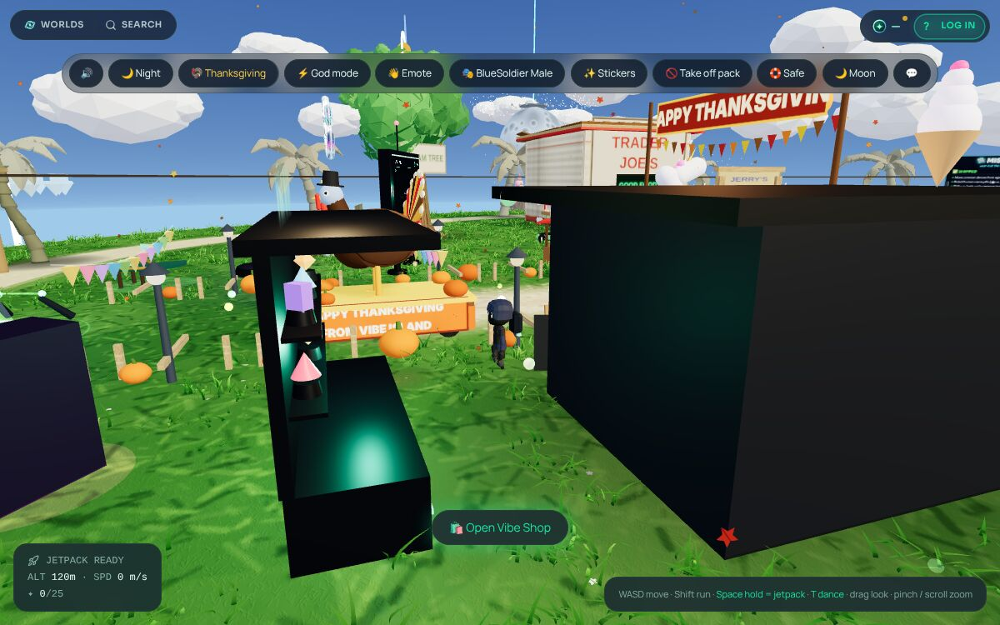

A magically weird island in the sky, and a neon city with a jetpack on your
back. Multiplayer, with your name over your head and stickers on your body.

- **GTA Junior:** pick up a Glock in the plaza or the rifle on the rooftop,
  set trees on fire, blow up buildings, and watch your **wanted stars** climb.
  The **police** come in black cruisers, and their cars explode too. Lie low
  for 63 seconds and they forgive you.
- **Bad guys and their hideout:** a warehouse with a roof pad where you summon
  villains who steal cars, and a **police station** across town. Two cops per
  bad guy. Jump on his roof and ride it.
- **A rideable police helicopter.**
- **Landmarks you can go up:** the Space Needle, the Empire State Building
  and the Eiffel Tower.
- Crashes with real damage, a monster truck, a rare Comet, go-karts, a ride-on
  lawnmower, **Pegasus** to fly, sky tag, a zipline, a zeppelin, the SnackFe
  cafe, Jerry, and a Thanksgiving parade with a turkey you can ride.
- Swim out into the bay and dive: there are wrecks on the bottom, and
  somewhere offshore it does not have a bottom at all.
- Spawn points for **Powder Peak** (ski), **The Moon** and **Vibe Star**.

### ✦ Build Mode: type a change, and it ships

Standing on Vibe Island, an admin hits **✦ Build** (Ctrl/Cmd+Shift+B), says
or types what they want ("add a ride-on lawnmower next to the go-karts"), and
**a Claude Code agent builds it** in GitHub Actions. It edits a branch, stays
inside a fenced set of files, has to pass typecheck and build, and then ships
to `main`. The lawnmower was the first one: about four minutes from sentence
to grass. There is a mic button, Fast (Sonnet) and Smart (Opus) modes, and
Stop, Retry, Edit and Undo.

The world, building itself, from inside the world.

### 🪄 The Magician · [`/magician`](https://myvibeverse.com/magician)

A valley village in rural Japan, with **Vibey** floating beside you in a
wizard's hat. **Talk to it.** Say "make it rain" and it rains. "Midnight."
"Northern lights." "Turn into a pug." "Cherry blossom forest." Wishes land
over two seconds so it feels like magic instead of a settings menu.

- A real-time **voice agent** (OpenAI Realtime) with tools that reshape the
  world, and a spellbook fallback so typing works too.
- **Vibey remembers you:** "Welcome back, Jack. Aurora again?"
- **Phones are wands:** put `/magician?show` on a big screen, everyone scans
  the QR code, and their phones become spell buttons. "Maya made it snow."
- **The Magic Screen:** ask Vibey to program the screen in the square and it
  writes the code live, safely sandboxed, for the whole room.
- Three mini-games where the weather is the weapon (rain drowns fire oni),
  Zombie Tag in the village, VR on Quest, and a built-in recorder.

### 🧟 Zombie Tag · [`/zombies`](https://myvibeverse.com/zombies)

Infection tag for a whole room at once: phones, laptops and a VR headset in
the same festival square. Put `/zombies?show` on the TV, everyone scans the
QR code, and one of you is a zombie. Anyone it touches turns green and starts
shambling. Last human standing wins. No host, no server deciding anything:
every device agrees from the same messages.

### 🌉 San Francisco · [`/sf`](https://myvibeverse.com/sf)

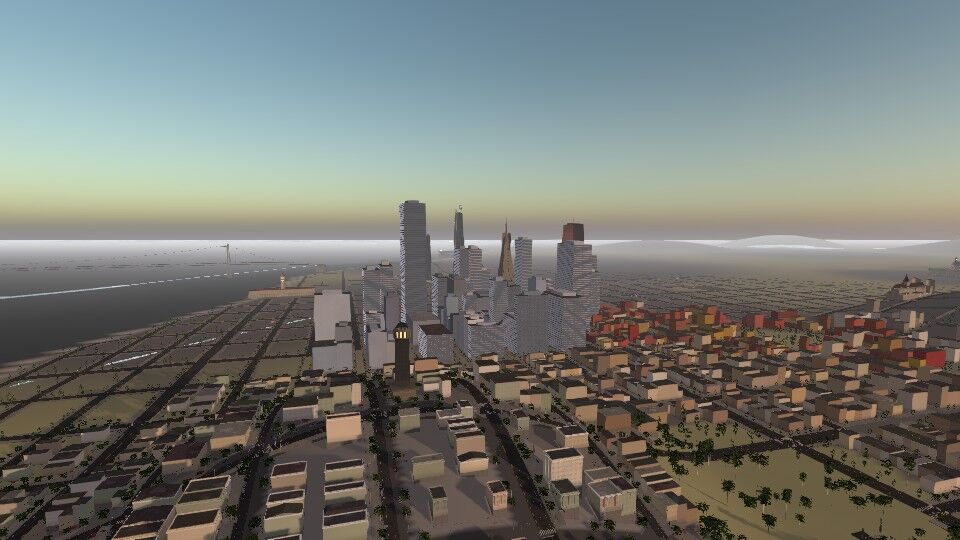

The real city, hill for hill and bridge for bridge, nine kilometres of it, in
**the weather San Francisco is actually having right now.** If Karl the Fog
is in off the Pacific this afternoon, he is in here too. Other players walk
it with you, any parked car is yours, there is a Mayhem mode at
[`/free-fall`](https://myvibeverse.com/free-fall), and the watercolour Terraces
on Twin Peaks climb to a pavilion at 440 metres. Its leaner sibling
[**Fog City**](https://myvibeverse.com/fogcity) is the from-scratch open-world
version built to fly on any laptop.

### 👤 My Vibe · [`/profile`](https://myvibeverse.com/profile)

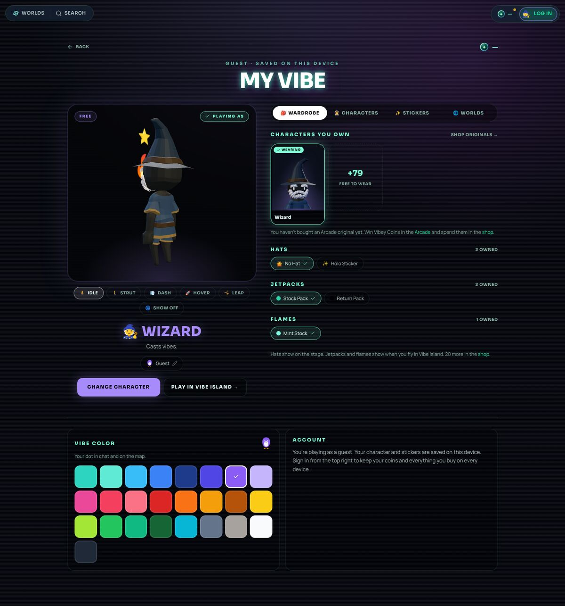 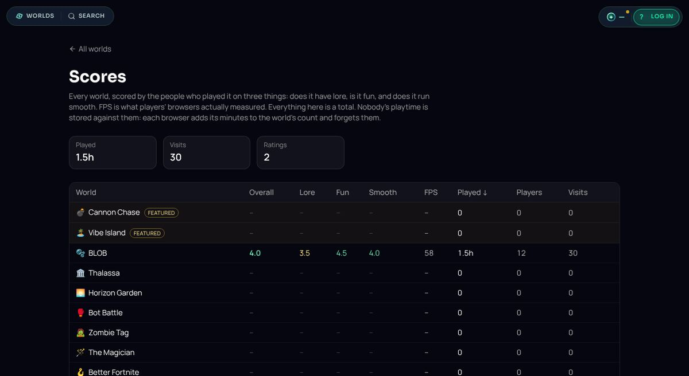

Your locker: pick a character (around sixty of them), dress it from the
**Vibe Shop** with hats, jetpacks and flames bought with **Vibecoin**, stick
stickers on it, and see which worlds carry you with them. Sign in with an
email code, a password, MetaMask or Google; it all ends in one session.

### 🏆 The Scoreboard · [`/scores`](https://myvibeverse.com/scores)

Every world, scored by the people who played it on **lore, fun and smooth**,
plus total hours played and real measured frame rate. Strictly anonymous:
nothing remembers who played, only how much.

---

## 🎮 The whole collection

Everything here is playable in a browser right now.
[**/game**](https://myvibeverse.com/game) is the same list with pictures.

### Play with friends (send the link)

| | | |
|---|---|---|
| 💣 **[Cannon Chase](https://myvibeverse.com/cannon-run)** | Two trucks, one keyboard, or a friend on their phone | `/cannon-run` |
| 🧟 **[Zombie Tag](https://myvibeverse.com/zombies)** | The whole room, one festival square | `/zombies` |
| 🪄 **[The Magician](https://myvibeverse.com/magician)** | A shared valley; phones become wands | `/magician` |
| 🏙️ **[Vibe City](https://myvibeverse.com/city)** | Jetpacks, sky tag, cops, chat | `/city` |
| 🌉 **[San Francisco](https://myvibeverse.com/sf)** | Walk the real city together | `/sf` |
| 🏁 **[Vibe Kart](https://myvibeverse.com/kart)** | Room code, up to six on the grid, rollback netcode | `/kart` |
| 💦 **[Splash Royale](https://myvibeverse.com/splash-royale)** | Water-gun battle royale, text a friend the code | `/splash-royale` |
| 🫧 **[BLOB](https://myvibeverse.com/blob)** | Eat or be eaten in a shared petri dish | `/blob` |
| 🐍 **[COIL](https://myvibeverse.com/coil)** | Snake arena where your shop character rides the front | `/coil` |
| 🥊 **[Bot Battle](https://myvibeverse.com/bots)** | Your X handle becomes a battle bot; dare a friend's | `/bots` |
| 🛰️ **[Orbit](https://myvibeverse.com/orbit)** | Same sky for everyone; best run takes the Vibecoin pot | `/orbit` |

### Games

| | | |
|---|---|---|
| 🪝 **Better Fortnite** · `/better-fortnite` | 🪂 **Drop Zero** · `/drop-zero` | 🌴 **San Palmas** · `/san-palmas` |
| ⛳ **Vibe Golf** (63 holes) · `/golf` | 🛰️ **The Vibeverse** · `/vibeverse` | 🐻 **Five Nights at Vibey's** · `/fnaf` |
| 🎄 **Home Alone** · `/home-alone` | 🛩️ **Airplane!** · `/airplane` | 🏃 **Run, Vibey, Run** · `/run` |
| 🖖 **The Final Frontier** · `/trek` | 🛸 **Strange New Worlds** · `/strange-new-worlds` | 🔦 **The Midnight Zone** · `/deep` |
| ♀️ **Venus Rising** · `/venus` | 👁 **I Spy** · `/i-spy` | 🔵 **Blue Angels** · `/blue-angels` |
| 🎈 **Pathfinder** (airship) · `/airship` | 🏃 **The Dipsea** · `/dipsea` | 🥽 **The Half-Blind Triathlon** · `/goggles` |
| 🏘️ **Developer Trail** · `/developer-trail` | 🏛️ **Agentocracy** · `/agentocracy` | 🏜️ **Mars College** · `/mars` |
| 🛵 **Flow Phangan** · `/phangan` | 🦆 **Duck On My Head** · `/duck` | 🛹 **Coast Road** · `/coast-road` |
| 🏜️ **The Dune Sea** · `/dunes` | 🔢 **Neon 2048** · `/2048` | 🧬 **Evolution** · `/evolve` |
| 🍉 **Fruit Ninja** (VR) · `/ninja` | 🌍 **Globetrotter** · `/globetrotter` | 📍 **Vibe GO** · `/go` |
| 🕹️ **Vibe Arcade** · `/arcade` | 🌁 **Fog City** · `/fogcity` | |

### Worlds to wander

| | | |
|---|---|---|
| 🛫 **The Terminal** · `/terminal` | 🏝️ **Vibe Island II** · `/island-2` | 🪐 **The Empyrean** · `/empyrean` |
| 🌅 **Horizon Garden** · `/horizon` | 🏛️ **Thalassa** (VR) · `/thalassa` | 🛩️ **Seafair 2117** · `/seafair` |
| 🌁 **Vibe Francisco** · `/frisco` | 🪴 **The Conservatory** · `/conservatory` | 🌌 **The Glass Lake** · `/glass-lake` |
| 🌒 **First Light** · `/first-light` | 🏡 **Beck Road** · `/beck-road` | 🧭 **Island Explorer** · `/island-explorer` |
| ⛷️ **Powder Peak** · `/city?spawn=ski` | 🌙 **The Moon** · `/city?spawn=moon` | 🗺️ **Healdsburg Village** · `/welcome` |

### Places to hang out

🪩 **EDM Town** `/edm-town` · 🌌 **Space Outpost** `/space` · 🌱 **Memory Garden** `/garden` ·
🖼️ **Fractal Museum** `/museum` · 🗞 **The Newsroom** `/newsroom` · 🛋️ **VIBE World** `/agent-lobby`
(an always-on room that AI agents join over HTTP)

### And the rest of the universe

🛂 **The Passport** `/passport` (a stamp for every world you visit) ·
📰 **The Vibe Times** `/times` (a newspaper written fresh every morning) ·
🪙 **Vibe Coin** `/coin` · 🛍️ **Vibe Shop** `/shop` · 📜 **The Chronicle** `/chronicle`
(every world in the order it was born, read out of git) · ✍️ **The Manifesto** `/manifesto` ·
🧪 **Agent Lab** `/companions` · 🛠️ **World Builder** `/world-builder`

---

## 🚪 Bring your own game

Built something? There are two doors.

- **[`/submit-game`](https://myvibeverse.com/submit-game)**: paste one link (a
  deployed game or a GitHub repo) and it lands on the arcade shelf inside the
  VibeVerse, sandboxed, on its own origin. Add four lines of
  [`vibeverse.js`](public/vibeverse.js) and it can **pay players in Vibey
  Coins**, from a daily allowance we hold, so a game can never mint money.
- **[`/submit-world`](https://myvibeverse.com/submit-world)**: send in a world
  for the hub, and [`/world-builder`](https://myvibeverse.com/world-builder)
  will write the prompt for you.

---

## 🛠️ How it is built

One Vite + React + TypeScript app. Each world is a nearly self-contained
engine in its own folder under `src/`, lazy-loaded so the front door opens
instantly. Every destination is one entry in
[`src/worlds/registry.ts`](src/worlds/registry.ts); the nav, the picker,
`/game`, the hub and the passport are all views of that one list.

- **Three.js** (pinned at 0.160) for nearly everything that draws, react-three-fiber in a few places, Mapbox for the real-map worlds.
- **Supabase** for auth, Realtime multiplayer, the economy, and 33 edge functions.
- **Four netcodes, on purpose:** rollback for kart racing, an authoritative
  host for BLOB, presence and chat for Vibe City, interpolation for San
  Francisco. Zombie Tag and the Magician have no host at all.
- **Voice:** OpenAI Realtime over WebRTC, with the key held by an edge function and a ten-free-minutes ledger.
- **Build mode:** Supabase function → GitHub Actions → Claude Code → `main`.
- **Lovable** hosts the live site; Claude Code, Cursor and Lovable write the code; a human looks at every frame.

The deep dives:

- **[ARCHITECTURE.md](./ARCHITECTURE.md)**: the full map, the engines, the numbers and the honest debt.
- **[CLAUDE.md](./CLAUDE.md)**: the working rules (push to `main`, verify before you push, how to add a world) and every hard-won lesson.
- **[WORLDBUILDING.md](./WORLDBUILDING.md)**: the Mapbox + Three.js half, from the village map where it all started.
- **[src/longsilence/README.md](./src/longsilence/README.md)**: how to vendor somebody else's game into a route.

### Run it locally

```bash
bun install            # bun.lock is the real lockfile; run `npm ci` too after touching package.json
bun dev                # http://localhost:8080
npm run typecheck      # never bare `tsc --noEmit`, it checks nothing here
npm run build          # must pass before anything is pushed: main is always live
npm test
npm run smoke -- /sf /kart    # open routes in a real Chromium and catch black screens
```

### Project layout

```
src/
  App.tsx              the router; every page is lazy()
  worlds/registry.ts   THE list of worlds; everything else is a view of it
  pages/               one thin page per route
  cannonrun/           Cannon Chase        magician/   The Magician
  city/                Vibe City + GTA Junior          oni/        Zombie Tag
  sf/                  San Francisco       kart/       Vibe Kart
  build-mode/          prompt-to-change    portal/     other people's games
  lib/ hooks/          the small shared core: identity, characters, passport, economy
supabase/functions/    edge functions: Vibey, voice, build mode, the paper, the economy
scripts/               capture, smoke, model optimisation and per-world check harnesses
```

---

## 💛 And friends

- **[Anshu Chimala](https://github.com/achimala/TheLongSilence)** wrote THE LONG
  SILENCE, which became `/vibeverse`. Vendored under MIT in `src/longsilence/`.
- Characters from [Quaternius](https://quaternius.com/) and
  [KayKit](https://kaylousberg.itch.io/) (CC0), props from
  [Meshy](https://www.meshy.ai/). Provenance in `src/assets/glb/CREDITS.md`.
- **Anyone can add a world.** That is the whole idea: everyone can build now,
  and every builder grows the universe.

<details>
<summary><b>Tools, references and inspiration</b> (the reading list)</summary>

### How the layers fit together

```
WebGL  ⟶  Three.js  ⟶  react-three-fiber / A-Frame  ⟶  the VibeVerse
(browser GPU API)   (3D library)   (declarative wrappers)
```

- **WebGL** is the browser's low-level GPU API. Powerful but verbose: you write shaders in GLSL and push vertex buffers by hand. <https://webglfundamentals.org/> is the best primer.
- **[Three.js](https://github.com/mrdoob/three.js/)** wraps WebGL into something usable: `new THREE.Mesh(geo, mat)`, scenes, cameras, GLTF loading.
- **[A-Frame](https://aframe.io/)** wraps Three.js into HTML markup. The fastest path to WebXR.
- **[react-three-fiber](https://github.com/pmndrs/react-three-fiber)** is Three.js as React components, with **[drei](https://github.com/pmndrs/drei)** as its standard library.

### 3D engines and helpers

| Tool | Why it's worth knowing |
|---|---|
| [Babylon.js](https://www.babylonjs.com/) | Microsoft-backed Three.js alternative, batteries included for game work. |
| [PlayCanvas](https://playcanvas.com/) | Browser-based Unity-like editor, exports to WebGL. |
| [Hyperfy](https://hyperfy.io/) | Open-source multiplayer 3D worlds. |
| [Rapier](https://rapier.rs/) | Rust physics in WASM. |
| [theatre.js](https://www.theatrejs.com/) | In-browser timeline animator for camera flights and keyframes. |
| [CesiumJS](https://cesium.com/platform/cesiumjs/) | 3D globe with real terrain. |
| [deck.gl](https://deck.gl/) | High-performance data layers on maps. |

### Asset creation

| Tool | What it does |
|---|---|
| [Meshy](https://www.meshy.ai/) | Text-to-3D and image-to-3D. |
| [Luma AI](https://lumalabs.ai/) | Text/image-to-3D plus NeRF captures. |
| [Spline](https://spline.design/) | Designer-friendly browser 3D editor. |
| [Sketchfab](https://sketchfab.com/) | Huge asset marketplace, lots of CC0. |
| [Poly Haven](https://polyhaven.com/) | Free CC0 HDRs, textures, models. |
| [Mixamo](https://www.mixamo.com/) | Free auto-rigging and humanoid animation. |
| [Blender](https://www.blender.org/) | The free, open-source standard. |
| [gltf-transform](https://gltf-transform.dev/) | Optimise GLBs; every model here goes through it (`scripts/glb-optimize.mjs`). |

### Inspiration

- The [Three.js examples gallery](https://threejs.org/examples/).
- [@om_patel5](https://twitter.com/om_patel5/status/2050062761229496425): a vibe-coded 3D game in a single weekend.
- [@andybroncek](https://twitter.com/andybroncek/status/2042931678989951197): beautifully art-directed 3D websites.
- [Bruno Simon's Three.js Journey](https://threejs-journey.com/).
- [Spatial.io](https://www.spatial.io/), [Mozilla Hubs](https://hubs.mozilla.com/) and early Decentraland, for social spaces.
- The [glTF specification](https://github.com/KhronosGroup/glTF).

</details>

<div align="center">

**[Open the VibeVerse →](https://myvibeverse.com)**

*Every line AI-written, human-directed. Keep rippin'.*

</div>
